

<picture><source media="(prefers-color-scheme: dark)" srcset="assets/hero-dark.svg"></picture>

<picture><source media="(prefers-color-scheme: dark)" srcset="assets/social-l-dark.svg"></picture><a href="https://t.me/pzwt4cc"><picture><source media="(prefers-color-scheme: dark)" srcset="assets/social-1-dark.svg"></picture></a><a href="https://discordapp.com/users/810041311062654987"><picture><source media="(prefers-color-scheme: dark)" srcset="assets/social-2-dark.svg"></picture></a><a href="https://www.pinterest.com/deidarochka2d/_pins/"><picture><source media="(prefers-color-scheme: dark)" srcset="assets/social-3-dark.svg"></picture></a><picture><source media="(prefers-color-scheme: dark)" srcset="assets/social-r-dark.svg"></picture>

<picture><source media="(prefers-color-scheme: dark)" srcset="assets/wave-dark.svg"></picture>

<picture><source media="(prefers-color-scheme: dark)" srcset="assets/about-dark.svg"></picture>

<picture><source media="(prefers-color-scheme: dark)" srcset="assets/stack-dark.svg"></picture>

<a href="https://github.com/pzwt4cc/mithril-viewer"><picture><source media="(prefers-color-scheme: dark)" srcset="assets/project-mithril-viewer-dark.svg"></picture></a>&nbsp;<a href="https://github.com/pzwt4cc/nulla"><picture><source media="(prefers-color-scheme: dark)" srcset="assets/project-nulla-dark.svg"></picture></a>

<a href="https://github.com/pzwt4cc/arabellity"><picture><source media="(prefers-color-scheme: dark)" srcset="assets/project-arabellity-dark.svg"></picture></a>&nbsp;<a href="https://github.com/pzwt4cc/Lirel"><picture><source media="(prefers-color-scheme: dark)" srcset="assets/project-lirel-dark.svg"></picture></a>

<picture><source media="(prefers-color-scheme: dark)" srcset="assets/stats-dark.svg"></picture>

<picture><source media="(prefers-color-scheme: dark)" srcset="assets/streak-dark.svg"></picture>

<a href="https://github.com/lostvalkrie"><picture><source media="(prefers-color-scheme: dark)" srcset="assets/maksik-dark.svg"></picture></a>

<picture><source media="(prefers-color-scheme: dark)" srcset="assets/button-l-dark.svg"></picture><a href="https://github.com/pzwt4cc?tab=repositories"><picture><source media="(prefers-color-scheme: dark)" srcset="assets/button-1-dark.svg"></picture></a><picture><source media="(prefers-color-scheme: dark)" srcset="assets/button-r-dark.svg"></picture>

<a href="https://metawka.github.io/expressive-profile/?from=pzwt4cc"><picture><source media="(prefers-color-scheme: dark)" srcset="assets/credit-dark.svg"></picture></a>

